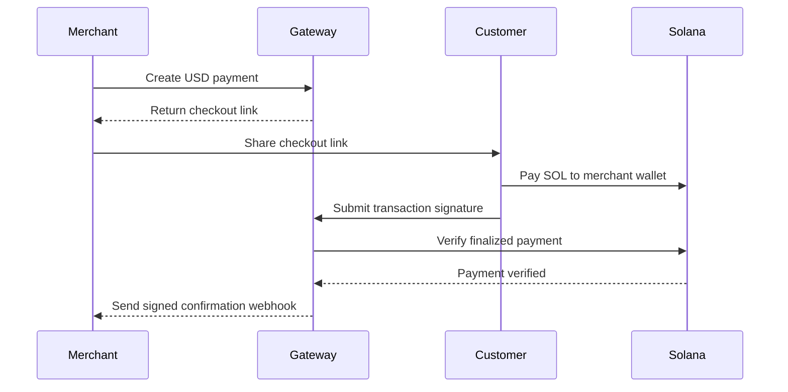

# Crypto Gateway — backend

A non-custodial payment API that lets merchants request payments in USD and
customers pay in SOL, directly to the merchant's wallet.

## Tech stack

| Layer                    | Technology                     |
| ------------------------ | ------------------------------ |
| API runtime              | TypeScript, Cloudflare Workers |
| Database                 | Cloudflare D1 (SQLite)         |
| Pricing                  | Jupiter Price API              |
| Transaction verification | Solana JSON-RPC                |
| Testing                  | Vitest, Miniflare              |

## System design

## Responsibilities

- Create payments and lock USD-to-SOL quotes for 15 minutes.
- Provide payment-scoped checkout access and payment status.
- Independently verify finalized transactions, including the recipient and exact amount.
- Deliver signed merchant notifications with automatic retries.

Submitting a transaction is not payment confirmation. Scheduled verification
continues even if the customer closes the checkout.

The gateway never holds funds or receives wallet private keys. Merchants remain
responsible for pricing, orders and fulfillment. Automated refunds are not supported.

## Integration

Merchant backends create and query payments using server-side credentials.
Checkout uses payment-scoped access rather than merchant credentials; provider
keys stay server-side.

Payment creation supports idempotency. Webhooks use at-least-once delivery, so
merchants must deduplicate notifications. Delivery retries up to 12 times;
exhausted events require operator review before an authorized replay.

See [the API specification](openapi.json) for endpoints, authentication and
request/response formats.

See [the payment architecture](docs/architecture.md) for quote arithmetic,
transaction verification and concurrency boundaries.
